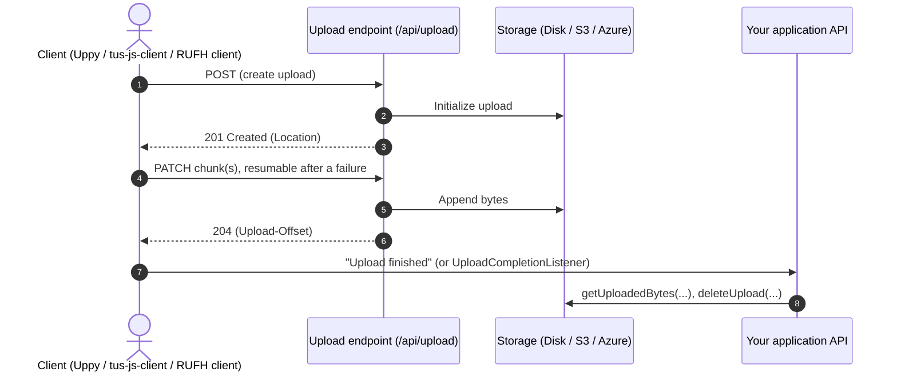

[](https://central.sonatype.com/artifact/me.desair.tus/tus-java-server) [](https://adoptium.net) [](https://github.com/tomdesair/tus-java-server/actions?query=branch%3Amaster+) [](https://coveralls.io/github/tomdesair/tus-java-server?branch=master) [](https://sonarcloud.io/dashboard?id=me.desair.tus%3Atus-java-server) [](https://sonarcloud.io/dashboard?id=me.desair.tus%3Atus-java-server) [](https://sonarcloud.io/dashboard?id=me.desair.tus%3Atus-java-server)

# tus-java-server

**Resumable (and potentially asynchronous) file uploads for any Java web application, with support for both the [tus 1.0.0](https://tus.io/) protocol and the new IETF [Resumable Uploads for HTTP (RUFH)](https://datatracker.ietf.org/doc/draft-ietf-httpbis-resumable-upload/) standard.**

This library lets the users of your application upload large files over slow and unreliable connections: an upload can be paused or resumed (after a connection loss or reset) without starting over. It implements the server side of the tus v1.0.0 protocol **and** the official IETF Resumable Uploads for HTTP specification (`draft-ietf-httpbis-resumable-upload`, draft-12) on the same endpoint, so tus clients (Uppy, `tus-js-client`) and IETF RUFH clients work side by side.

Javadoc: https://tus.desair.me/ · Requires Java 17+ (Jakarta Servlet 6.0) · Upgrading from 1.x? See the [Upgrade Guide](docs/UPGRADING.md).

## Key Features
* ⚡ **IETF RUFH Ready**: Implements the official [IETF Resumable Uploads for HTTP (draft-12)](https://datatracker.ietf.org/doc/draft-ietf-httpbis-resumable-upload/) — including `Upload-Complete`, `Upload-Limit`, RFC 7807 problem details, RFC 9530 digests and `104` interim responses — alongside full [Tus 1.0.0](https://tus.io/) support. Protocol is auto-detected per request. *(RUFH is still an IETF draft, so treat that part as experimental until it becomes an RFC.)*
* ☁️ **Pluggable Storage Backends**: Local Disk Volumes, NFS network shares, S3-compatible Object Storage (AWS S3, MinIO, Cloudflare R2, Ceph, GCS), and Azure Blob Storage.
* 🔒 **Zero-Database Distributed Locking**: Built-in lease-based locking enabling multi-replica cluster & Kubernetes container deployments without requiring Redis or relational databases.
* 🛡️ **Data Integrity & Resiliency**: Built-in HTTP Digests ([RFC 9530](https://www.rfc-editor.org/rfc/rfc9530.html)), checksum verification, and duplicate upload deduplication.
* 🚀 **Production-Ready & Lightweight**: Minimal dependencies (Jakarta Servlet API 6.0 & Apache Commons), non-blocking lock contention resolution, and thread-local caching.

## Table of Contents
- [Quick Start](#quick-start)
- [Try It with curl](#try-it-with-curl)
- [How It Works](#how-it-works)
- [Documentation](#documentation)
- [Compatible Clients & Conformity Testing](#compatible-clients--conformity-testing)
- [Versioning](#versioning)
- [Contributing](#contributing)

## Quick Start

### 1. Add the dependency

**Maven:**
```xml
<dependency>
  <groupId>me.desair.tus</groupId>
  <artifactId>tus-java-server</artifactId>
  <version>2.0.0</version>
</dependency>
```

**Gradle (Groovy):**
```groovy
implementation 'me.desair.tus:tus-java-server:2.0.0'
```

**Gradle (Kotlin):**
```kotlin
implementation("me.desair.tus:tus-java-server:2.0.0")
```

S3 and Azure backends need an additional SDK dependency, see the [Configuration Reference](docs/CONFIGURATION.md#dependencies).

### 2. Create the service (once) and forward requests to it

The main entry point is `me.desair.tus.server.TusFileUploadService.process(HttpServletRequest, HttpServletResponse)`. Call it from any `HttpServlet`, `Filter` or REST controller that gives you the servlet request and response. Create the service **once** (it is thread-safe) and share it. By default uploads are stored on a (shared) file volume.

**Spring Boot 3** (`spring-boot-starter-web`, Java 17+). The snippets are complete and compile as-is; adjust the paths:

```java
import me.desair.tus.server.TusFileUploadService;
import org.springframework.context.annotation.Bean;
import org.springframework.context.annotation.Configuration;

@Configuration
public class TusConfig {

  @Bean(destroyMethod = "close")
  public TusFileUploadService tusFileUploadService() {
    return new TusFileUploadService()
        .withStoragePath("/path/to/uploads")
        .withUploadUri("/api/upload")
        .withUploadDeduplication(true)
        .withThreadLocalCache(true);
  }
}
```

```java
import jakarta.servlet.http.HttpServletRequest;
import jakarta.servlet.http.HttpServletResponse;
import java.io.IOException;
import me.desair.tus.server.TusFileUploadService;
import org.springframework.web.bind.annotation.RequestMapping;
import org.springframework.web.bind.annotation.RequestMethod;
import org.springframework.web.bind.annotation.RestController;

@RestController
public class FileUploadController {

  private final TusFileUploadService tusFileUploadService;

  public FileUploadController(TusFileUploadService tusFileUploadService) {
    this.tusFileUploadService = tusFileUploadService;
  }

  @RequestMapping(
      value = {"/api/upload", "/api/upload/**"},
      method = {
        RequestMethod.POST,
        RequestMethod.PUT,
        RequestMethod.PATCH,
        RequestMethod.HEAD,
        RequestMethod.DELETE,
        RequestMethod.OPTIONS,
        RequestMethod.GET
      })
  public void processUpload(HttpServletRequest request, HttpServletResponse response)
      throws IOException {
    tusFileUploadService.process(request, response);
  }
}
```

**Plain Jakarta Servlet 6 (Tomcat 10+, Jetty 12, Undertow...)**

```java
import jakarta.servlet.annotation.WebServlet;
import jakarta.servlet.http.HttpServlet;
import jakarta.servlet.http.HttpServletRequest;
import jakarta.servlet.http.HttpServletResponse;
import java.io.IOException;
import me.desair.tus.server.TusFileUploadService;

@WebServlet("/api/upload/*")
public class UploadServlet extends HttpServlet {

  private TusFileUploadService tus;

  @Override
  public void init() {
    tus =
        new TusFileUploadService()
            .withStoragePath("/path/to/uploads")
            .withUploadUri("/api/upload")
            .withUploadDeduplication(true)
            .withThreadLocalCache(true);
  }

  @Override
  protected void service(HttpServletRequest req, HttpServletResponse resp) throws IOException {
    // Override service() (not doPost/doGet) so that PATCH, HEAD and OPTIONS reach the library
    tus.process(req, resp);
  }

  @Override
  public void destroy() {
    try {
      tus.close();
    } catch (IOException e) {
      log("Failed to close TusFileUploadService", e);
    }
  }
}
```

CORS and `OPTIONS` preflight are handled by the library itself. More variants (multi-tenancy, cleanup, security) are in the [Integration Guide](docs/INTEGRATION_GUIDE.md).

> [!NOTE]
> When using Spring Security, the upload endpoint must be authenticated like any other endpoint, but `OPTIONS` preflight requests must be allowed through. If your Spring Boot setup uses a `/api` prefix or context path, make sure `withUploadUri(...)` matches the path as seen by the application.

### 3. Handle finished uploads

Register an `UploadCompletionListener` on the service from step 2 (Spring Boot version shown, replace the `TusConfig` class):

```java
import java.io.InputStream;
import java.nio.file.Files;
import java.nio.file.Paths;
import me.desair.tus.server.TusFileUploadService;
import org.slf4j.Logger;
import org.slf4j.LoggerFactory;
import org.springframework.context.annotation.Bean;
import org.springframework.context.annotation.Configuration;

@Configuration
public class TusConfig {

  private static final Logger log = LoggerFactory.getLogger(TusConfig.class);

  @Bean(destroyMethod = "close")
  public TusFileUploadService tusFileUploadService() {
    return new TusFileUploadService()
        .withStoragePath("/path/to/uploads")
        .withUploadUri("/api/upload")
        .withUploadDeduplication(true)
        .withThreadLocalCache(true)
        .withUploadCompletionListener(
            (uploadInfo, service) -> {
              // Safely retrieve or guess the file name (preventing path traversal and NPE)
              String fileName = Paths.get(uploadInfo.getFileName()).getFileName().toString();
              try {
                try (InputStream is = service.getUploadedBytes(uploadInfo)) {
                  Files.copy(is, Paths.get("/var/data/documents", fileName));
                } // closing the stream releases the lock, which deleteUpload needs
                service.deleteUpload(uploadInfo);
              } catch (Exception e) {
                log.error("Failed to process completed upload {}", uploadInfo.getId(), e);
              }
            });
  }
}
```

Alternatively let the client notify your own REST endpoint and call `getUploadInfo`, `getUploadedBytes` and `deleteUpload` there. Also schedule `tusFileUploadService.cleanup()` to remove expired uploads. See [Handling Upload Completion](docs/INTEGRATION_GUIDE.md#2-handling-upload-completion--retrieving-files) and [Cleanup](docs/INTEGRATION_GUIDE.md#3-cleanup).

### 4. Connect a client

```javascript
import Uppy from '@uppy/core';
import Tus from '@uppy/tus';

const uppy = new Uppy().use(Tus, {
  endpoint: 'http://localhost:8080/api/upload',
  chunkSize: 5 * 1024 * 1024 // 5MB chunk size
});
```

Complete working examples:

* [Resumable and asynchronous file upload in Spring Boot REST API with Uppy JavaScript client.](https://github.com/tomdesair/tus-java-server-spring-demo)
* [Detailed blog post by Ralph](https://golb.hplar.ch/2019/06/upload-with-tus.html) on how to use this library in [Spring Boot in combination with the Tus JavaScript client](https://github.com/ralscha/blog2019/tree/master/uploadtus).
* [Resumable and asynchronous file upload using Uppy with form submission in Dropwizard (Jetty)](https://github.com/tomdesair/tus-java-server-dropwizard-demo)

The `scripts/` folder contains runnable Python test clients for both protocols ([Conformity Testing Guide](docs/CONFORMITY_TESTING.md)).

## Try It with curl

Verify your endpoint without a frontend (replace the URL and use the `Location` header returned by the `POST`).

**IETF Resumable Uploads (RUFH)**
```bash
# 1. Create the upload resource (more data will follow)
curl -i -X POST http://localhost:8080/api/upload -H "Upload-Complete: ?0"
# 2. Send the data and mark the upload as complete
curl -i -X PATCH http://localhost:8080/api/upload/<id> \
  -H "Upload-Offset: 0" -H "Upload-Complete: ?1" \
  -H "Content-Type: application/partial-upload" --data-binary "hello world"
# 3. Query progress at any time
curl -I http://localhost:8080/api/upload/<id>
```

**Tus 1.0.0**
```bash
curl -i -X POST http://localhost:8080/api/upload \
  -H "Tus-Resumable: 1.0.0" -H "Upload-Length: 11" -H "Upload-Metadata: filename aGVsbG8udHh0"
curl -i -X PATCH http://localhost:8080/api/upload/<id> \
  -H "Tus-Resumable: 1.0.0" -H "Upload-Offset: 0" \
  -H "Content-Type: application/offset+octet-stream" --data-binary "hello world"
curl -I http://localhost:8080/api/upload/<id> -H "Tus-Resumable: 1.0.0"
```

## How It Works

Your application only forwards HTTP requests to `TusFileUploadService`; the library implements the protocol, stores the bytes in a pluggable backend, locks uploads against concurrent writers and resolves lock contention when a client resumes. Your application consumes the finished upload and deletes it.



Detailed Tus and RUFH flow diagrams: [Protocols](docs/PROTOCOLS.md).

## Documentation

| Topic | Guide |
|---|---|
| Overview of all documents | [Documentation index](docs/README.md) |
| `process()`, completion, cleanup, multi-tenancy, security, frontend | [Integration Guide](docs/INTEGRATION_GUIDE.md) |
| All `with...()` options, storage backend selection, dependencies | [Configuration Reference](docs/CONFIGURATION.md) |
| Tus vs. IETF RUFH, protocol version selection, extensions, HTTP digests, 104 responses | [Protocols](docs/PROTOCOLS.md), [Migrating clients to RUFH](docs/MIGRATION.md), [Interim responses](docs/INTERIM_RESPONSES.md) |
| Multi-replica, Kubernetes, reverse proxies | [Deployment Guide](docs/DEPLOYMENT.md), [Locking](docs/LOCKING.md) |
| Storage backends | [Disk & network (NFS/EFS/SMB)](docs/DISK_BASED_LOCKING.md), [S3-compatible](docs/S3_STORAGE.md), [Azure Blob](docs/AZURE_BLOB_STORAGE.md) |
| Problems | [Troubleshooting](docs/TROUBLESHOOTING.md) |
| Upgrading from 1.x | [Upgrade Guide](docs/UPGRADING.md), [CHANGELOG](CHANGELOG.md) |

## Compatible Clients & Conformity Testing

The server is tested with [Uppy](https://uppy.io/), `tus-js-client`, the built-in Tus v1.0.0 and RUFH (draft-12 and RFC 9530) conformity suites in `scripts/` across Disk, S3 and Azure Blob backends, and the community [RUFH conformity tests from the IETF hackathon](https://github.com/tus/ietf-hackathon). See [Protocols](docs/PROTOCOLS.md#compatible-clients--conformity-testing) and the [Conformity Testing Guide](docs/CONFORMITY_TESTING.md).

## Versioning
This artifact follows `MAJOR.MINOR.PATCH` semantic versioning. Version `2.0.0` introduces major dual-protocol support for both Tus 1.0.0 and the IETF Resumable Uploads for HTTP specification (`draft-ietf-httpbis-resumable-upload`). Version `1.0.0-3.3` was the last Tus protocol-only version.

## Contributing
This library comes without any warranty and is released under a [MIT license](https://github.com/tomdesair/tus-java-server/blob/master/LICENSE). Bug reports, ideas and pull requests are welcome; contributed code needs automated tests and must follow the Google Java Style. See [CONTRIBUTING.md](CONTRIBUTING.md) for details, code style and testing instructions.
