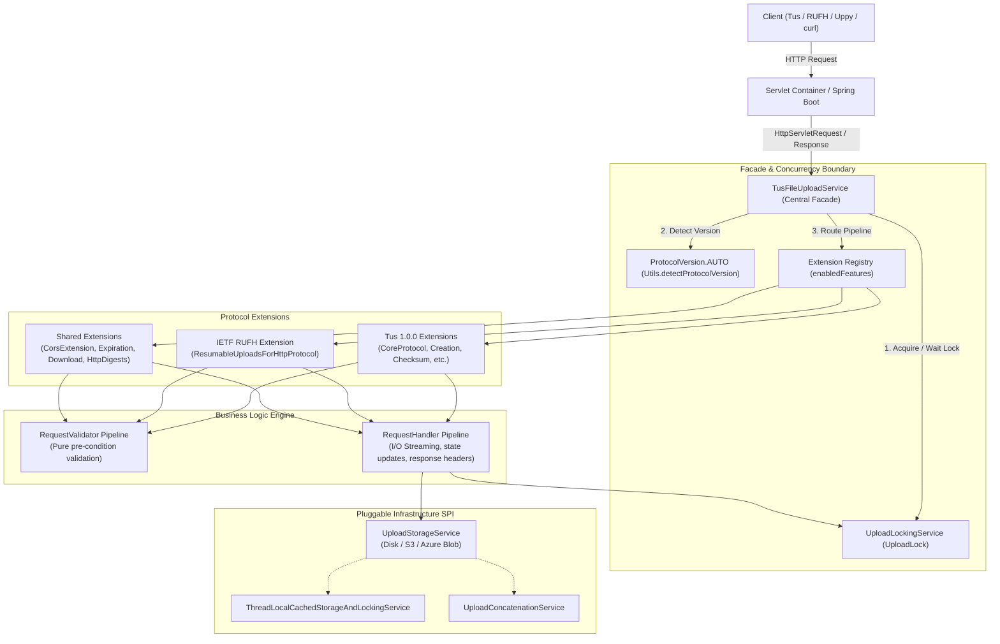
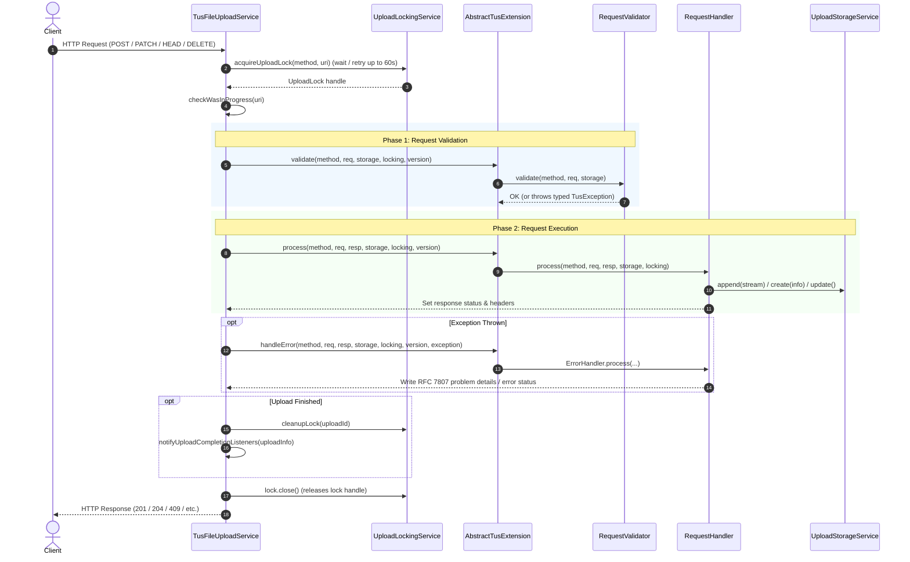
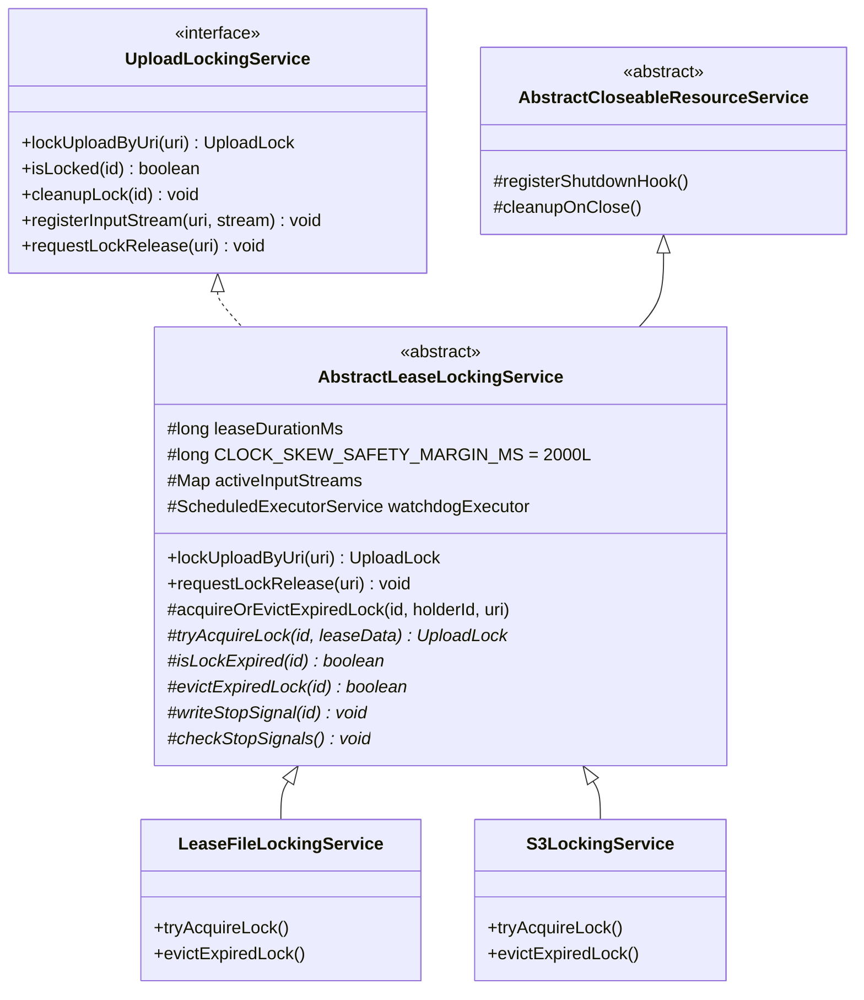
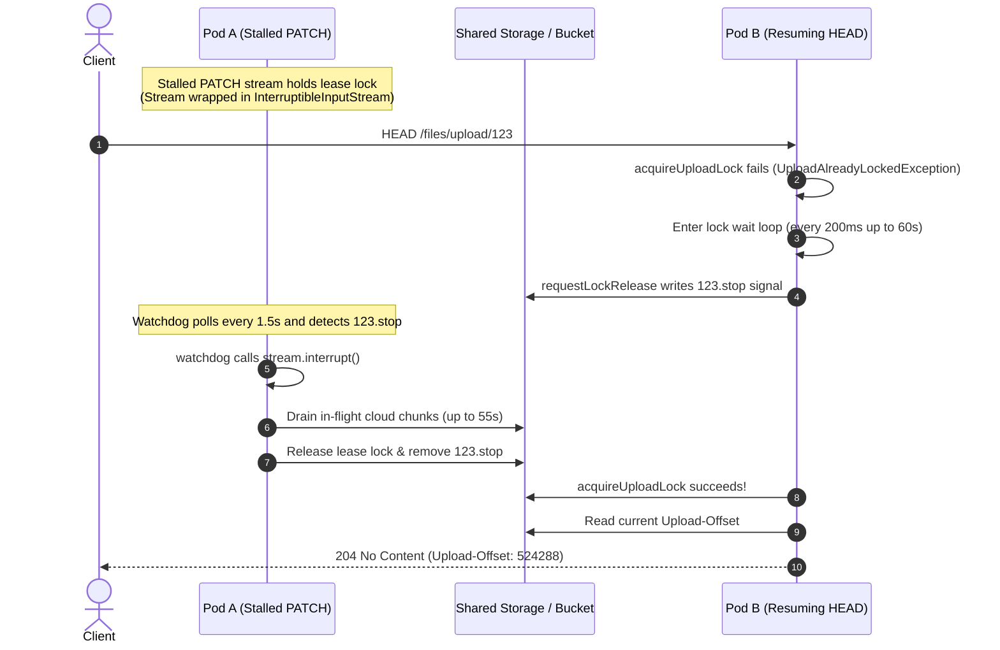
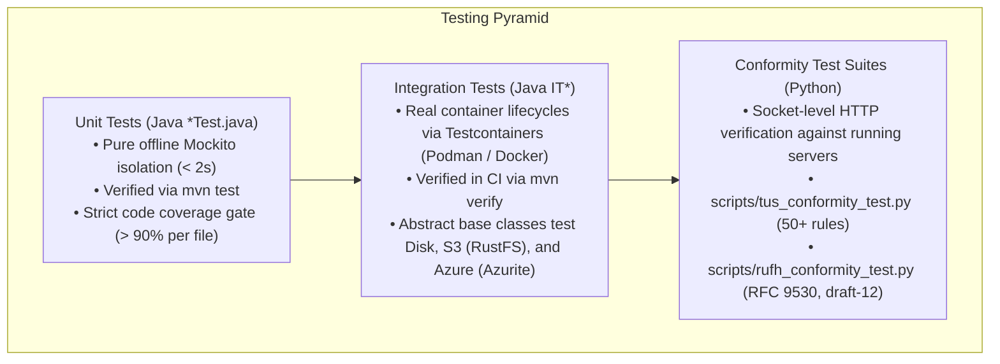

# Architecture Guide: tus-java-server

This document describes the architectural design of `tus-java-server`. It is written for developers and contributors who want to understand how the library works internally, how requests flow through the system, and where to place new functionality.

---

## 1. Architectural Philosophy

`tus-java-server` is an embeddable, container-native resumable upload library for **Java 17+** and **Jakarta EE** (`jakarta.servlet.*`). Its design is guided by four principles:

1. **Single Central Service Class**: A single facade—[`TusFileUploadService`](../src/main/java/me/desair/tus/server/TusFileUploadService.java)—acts as the public API entry point and orchestrator. It manages configuration, concurrency boundaries, and extension execution without protocol-specific branching.
2. **Protocol Composition via Extensions**: Protocols are not hardcoded monoliths. Both supported protocols (**Tus 1.0.0** and **IETF RUFH**) are composed of modular extensions extending [`AbstractTusExtension`](../src/main/java/me/desair/tus/server/util/AbstractTusExtension.java).
3. **Business Logic in Validators & Handlers**: All protocol rules, request checks, and byte operations reside exclusively in dedicated [`RequestValidator`](../src/main/java/me/desair/tus/server/RequestValidator.java) and [`RequestHandler`](../src/main/java/me/desair/tus/server/RequestHandler.java) implementations.
4. **Zero External Coordination Dependencies by Default**: Out-of-the-box distributed locking uses atomic filesystem leases and POSIX sibling mutexes. No Redis, ZooKeeper, or database cluster is required to achieve multi-replica container safety.

---

## 2. High-Level Component Architecture

The diagram below illustrates how incoming HTTP requests flow through the library down to the physical storage and locking abstractions:



---

## 3. Dual Protocols Composed of Extensions

`tus-java-server` serves **two resumable upload protocols** on the exact same endpoint:

1. **Tus 1.0.0**: The widely-adopted [tus protocol standard](https://tus.io/protocols/resumable-upload.html).
2. **IETF Resumable Uploads for HTTP (RUFH)**: The official standardization draft ([draft-ietf-httpbis-resumable-upload-12](https://datatracker.ietf.org/doc/draft-ietf-httpbis-resumable-upload/)).

By default, the service operates in `ProtocolVersion.AUTO` mode: it inspects incoming HTTP headers per request (`Tus-Resumable` activates Tus 1.0.0; `Upload-Complete` or `Content-Type: application/partial-upload` activates RUFH).

### Protocol Composition Matrix

Each protocol is built from a combination of **mandatory** and **optional** extensions:

| Protocol | Mandatory Extensions | Optional Extensions |
|---|---|---|
| **Tus 1.0.0** | `CoreProtocol` (core `OPTIONS`, `HEAD`, `PATCH`) | `CreationExtension`, `CreationWithUploadExtension`, `ChecksumExtension`, `TerminationExtension`, `ExpirationExtension`, `ConcatenationExtension`, `CorsExtension`, `DownloadExtension` |
| **IETF RUFH** | `ResumableUploadsForHttpProtocol` (`OPTIONS`, `HEAD`, `GET`, `POST`, `PUT`, `PATCH`, `DELETE`) | `HttpDigestsExtension` (RFC 9530 digests), `ExpirationExtension` (`max-age`), `CorsExtension`, `DownloadExtension` |

- **Mandatory Extensions**: `CoreProtocol` cannot be disabled; it defines core byte offset tracking and stream resumption for Tus 1.0.0. For RUFH requests, `ResumableUploadsForHttpProtocol` is the mandatory protocol handler.
- **Optional Extensions**: Can be disabled at runtime via `service.disableTusExtension("name")` or enabled on demand (e.g. `service.withDownloadFeature()`).

---

## 4. The Validator & Handler Pipeline

All protocol business logic is decoupled into two interfaces:

### 1. `RequestValidator` (Validation Phase)
- **Role**: Pure, side-effect-free pre-condition verification.
- **Contract**: Inspects request headers and parameters. If invalid, throws a typed [`TusException`](../src/main/java/me/desair/tus/server/exception/TusException.java) containing the exact HTTP status code (e.g., `400 Bad Request`, `404 Not Found`, `409 Conflict`, `412 Precondition Failed`, `413 Payload Too Large`).
- **Examples**: `TusResumableValidator`, `UploadOffsetValidator`, `RufhCreationValidator`, `RufhAppendValidator`.

### 2. `RequestHandler` (Execution & Error Phase)
- **Role**: State mutation, byte payload ingestion, response header generation, and error formatting.
- **Contract**:
  - Standard handlers (`isErrorHandler() == false`): Streams upload bytes, updates offsets in storage, sets protocol headers (`Upload-Offset`, `Location`, `Upload-Limit`).
  - Error handlers (`isErrorHandler() == true`): Intercepts thrown exceptions to emit protocol-specific error payloads, such as RFC 7807 problem details (`application/problem+json` in `RufhErrorHandler`).
- **Examples**: `CorePatchRequestHandler`, `RufhCreationPostRequestHandler`, `RufhErrorHandler`.

### Request Lifecycle Sequence

The sequence below details the execution of `TusFileUploadService.process(...)`:



---

## 5. Pluggable Storage Backend Architecture

File storage and metadata persistence are decoupled behind the [`UploadStorageService`](../src/main/java/me/desair/tus/server/upload/UploadStorageService.java) SPI.

```
UploadStorageService
├── DiskStorageService (Filesystem & Network Shares)
├── S3StorageService (AWS S3, MinIO, RustFS, Ceph, Cloudflare R2)
└── AzureBlobStorageService (Azure Blob Storage Block Blobs)
```

### Two Disk Storage Implementations

For local filesystems and shared network volumes, `tus-java-server` provides two distinct concurrency/storage combinations:

1. **Current / Default: Lease File Based (`DiskStorageService` + `LeaseFileLockingService`)**:
   - Configured automatically via `withStoragePath(String)`.
   - Replaces OS kernel file locks with atomic sibling mutex directories (`<UploadId>.mutex/`) and JSON lease metadata (`lease.json`).
   - Works safely across multi-replica container clusters, Kubernetes pods (`ReadWriteMany`), AWS EFS, Azure Files, SMB, and NFSv3/v4 mounts without requiring `rpc.statd` or external databases.
2. **Legacy Opt-Out: File Lock Based (`DiskStorageService` + `DiskLockingService`)**:
   - Opt-out via `withUploadStorageService(new DiskStorageService(...)).withUploadLockingService(new DiskLockingService(...))`.
   - Uses OS kernel-level locks (`java.nio.channels.FileLock` via POSIX `fcntl` or Windows `LockFileEx`).
   - Suitable strictly for single-node deployments on local disk.

### Cloud Storage Implementations

- **`S3StorageService`**: Stores chunks as S3 objects and concatenates them using multipart upload copy or compose helpers (`S3ConcatenationService`).
- **`AzureBlobStorageService`**: Stages chunks as uncommitted block blobs using `.part` temporary buffers and commits block lists atomically upon completion. Zero-copy concatenation is supported via `stageBlockFromUrl`.

### Storage Extensions & Helpers

- **Upload Concatenation SPI (`UploadConcatenationService`)**: Supports merging parallel chunk uploads into a single final resource. Implemented natively for Disk (`VirtualConcatenationService`), S3 (`S3ConcatenationService`), and Azure (`AzureBlobConcatenationService`).
- **Upload Deduplication**: Enabled via `.withUploadDeduplication(true)`. Completed uploads are indexed by checksum. Duplicate uploads are linked via `duplicatesUploadId`. Read operations dynamically resolve to the parent upload, while write and truncation operations strictly operate on the target upload to prevent corrupting parent data.
- **Thread-Local Request Caching (`ThreadLocalCachedStorageAndLockingService`)**: Enabled via `.withThreadLocalCache(true)`. Caches `UploadInfo` in memory for the duration of a single HTTP request to eliminate redundant network roundtrips to S3 or Azure Blob Storage.

### Implementing a Custom Storage Backend

Custom storage engines (e.g. Google Cloud Storage, relational database BLOB stores, or custom object systems) implement the [`UploadStorageService`](../src/main/java/me/desair/tus/server/upload/UploadStorageService.java) interface:

1. **Upload Lifecycle**:
   - `create(UploadInfo, String)`: Allocate initial storage resources and persist the upload metadata record.
   - `append(UploadInfo, InputStream)`: Stream and append incoming payload chunks to storage. Persist partial progress if interrupted.
   - `getUploadInfo(UploadId)` / `update(UploadInfo)`: Retrieve and update upload metadata.
   - `getUploadedBytes(UploadId)` / `copyUploadTo(UploadInfo, OutputStream)`: Stream completed file bytes to consumers.
2. **Resource Termination & Lock Cleanup Contract (`terminateUpload`)**:
   `terminateUpload(UploadInfo)` is the single authoritative method responsible for freeing all resources when an upload is deleted, cancelled, or expired. Custom implementations must:
   - Free physical committed data bytes and any temporary chunk buffers.
   - Delete the metadata record (`.info`).
   - Coordinate deduplication index removal or tombstoning via `deduplicationService.removeUploadFromIndex(uploadInfo)` when deduplication is active.
   - **Delegate Lock Cleanup**: Call `uploadLockingService.cleanupLock(uploadInfo.getId())`, ensuring no orphaned lock files, stop signals, or lease objects remain in the locking layer.
3. **Mandatory Locking Service**:
   An `UploadLockingService` is mandatory across all storage backends. Storage services receive their `UploadLockingService` reference via `setUploadLockingService(UploadLockingService)` (enforcing non-null). For unit tests or specialized embedding environments where locking is bypassed, [`NoOpUploadLockingService`](../src/main/java/me/desair/tus/server/upload/NoOpUploadLockingService.java) provides a zero-overhead Null Object implementation.
4. **Supporting Checksum Deduplication**:
   When upload deduplication is enabled (`.withUploadDeduplication(true)`), storage backends must implement the following critical interface methods:
   - `deduplicate(UploadInfo, ChecksumKey)`: Coordinate cluster-safe deduplication upon upload completion. Storage backends typically instantiate a [`DeduplicationService`](../src/main/java/me/desair/tus/server/upload/checksum/DeduplicationService.java) backed by a custom [`ChecksumIndex`](../src/main/java/me/desair/tus/server/upload/checksum/ChecksumIndex.java) implementation to check for an existing parent, link the child upload, or register a new parent.
   - `dataExists(UploadId)`: Return `true` if physical committed data exists for the upload ID. The deduplication service invokes this method during parent lookup to detect out-of-band data deletions and automatically self-heal stale checksum index entries. *(The default interface method returns `false`, which disables parent reuse if not overridden.)*
   - `deleteData(UploadId)`: Delete physical committed data bytes without removing the upload's `.info` metadata record. This is invoked to free physical storage when a duplicate upload is linked to an existing parent, and to purge retained parent data when the last active child terminates. *(The default interface method is a no-op, which leaks storage if not overridden.)*
   - `setUploadDeduplicationEnabled(boolean)` / `isUploadDeduplicationEnabled()`: Store and expose whether deduplication is active.
   - **Read/Write Safety Rules**:
     - *Read operations* (`getUploadedBytes`, `copyUploadTo`) MUST check `uploadInfo.getDuplicatesUploadId()` and dynamically stream bytes from the parent upload if set.
     - *Write and mutation operations* (`append`, `removeLastNumberOfBytes`) MUST NEVER resolve `duplicatesUploadId` to the parent; they must operate strictly on child storage to prevent mutating parent data.
5. **Optional Features & Extensions**:
   - `UploadConcatenationService`: Implement concatenation to support merging parallel chunk uploads into a single final resource.
   - Size limits: Implement `setMinAppendSize`, `setMaxAppendSize`, `setMinSize`, and `setMaxUploadSize` to enforce upload payload constraints.
   - Cloud streaming: Implement `setCloudUploadThreadPoolSize` and `setDrainTimeout` for asynchronous chunk uploaders.
   - Cleanup: Implement `close()` to release underlying network clients, thread pools, or file descriptors.


---

## 6. Distributed Locking & Lock Contention Resolution

Resumable uploads require exclusive concurrency control per upload resource to prevent race conditions (e.g., overlapping byte appends or simultaneous resume and delete requests).

All locking backends implement [`UploadLockingService`](../src/main/java/me/desair/tus/server/upload/UploadLockingService.java) and return [`UploadLock`](../src/main/java/me/desair/tus/server/upload/UploadLock.java) handles. When no concurrency control is needed, [`NoOpUploadLockingService`](../src/main/java/me/desair/tus/server/upload/NoOpUploadLockingService.java) acts as the null-safe implementation.

### Building Lease-Based Lock Providers: `AbstractLeaseLockingService`

Custom distributed locking services (or extensions for GCP, Redis, DynamoDB, etc.) should extend [`AbstractLeaseLockingService`](../src/main/java/me/desair/tus/server/upload/AbstractLeaseLockingService.java):



**Key Features of `AbstractLeaseLockingService`**:
1. **Clock Skew Safety Margin**: Built-in 2.0-second buffer (`CLOCK_SKEW_SAFETY_MARGIN_MS = 2000L`) absorbs NTP drift between cluster nodes, preventing premature lease eviction.
2. **Stream Interruption Registry**: Tracks active in-flight input streams in `activeInputStreams` and interrupts them cleanly via `Utils.interruptStream(...)`.
3. **Contention Dispatch & Polling Watchdog**: When contention is detected, dispatches a `.stop` signal and runs a background watchdog executor (`Utils.scheduleWatchdog(...)`) to terminate paused streams on remote nodes.
4. **TOCTOU-Safe Eviction with Jitter**: Implements randomized backoff jitter (`jitterMinMs` to `jitterMaxMs`) to prevent thundering herd collisions when multiple nodes contend for an expired lease.

### Cross-Node Lock Contention Resolution

When a client loses network connectivity, the server's `PATCH` socket may remain stalled in a half-open state. When the client resumes with a `HEAD` request (or cancels with `DELETE`), contention is resolved across nodes:



For more details on locking mechanisms, see [`docs/LOCKING.md`](LOCKING.md) and [`docs/DISK_BASED_LOCKING.md`](DISK_BASED_LOCKING.md).

---

## 7. Three-Tiered Testing Strategy

The repository maintains high reliability across protocols and storage engines via three testing tiers:



1. **Unit Tests (`*Test.java`)**: Target specific classes in complete isolation with Mockito. Zero container or network requirements. Executed rapidly via `mvn test -q`. Coverage is verified via `python3 scripts/check-coverage.py --per-file-limit 90`.
2. **Integration Tests (`IT*`)**: End-to-end multi-backend verification running under `mvn verify -q`. Tests spin up dynamic local containers via Testcontainers using **either Podman or Docker**. Base classes (`AbstractITRufhProtocol`, `AbstractITTusFileUploadService`) ensure identical test coverage across Disk, S3, and Azure backends.
3. **Conformity Tests (`scripts/*_conformity_test.py`)**: Black-box Python test suites executed against live server deployments (e.g. `tus-java-server-spring-demo` on port 8080) to validate strict specification compliance.

For detailed testing instructions, see [`docs/TESTING.md`](TESTING.md) and [`docs/CONFORMITY_TESTING.md`](CONFORMITY_TESTING.md).

---

## 8. Contributor Blueprint: Where to Add New Functionality

| Task | Where to Implement | Key Guidelines |
|---|---|---|
| **Add a Request Validation Rule** | Create a class implementing `RequestValidator` in the target extension's `validation` package. | Keep validation side-effect-free. Throw typed `TusException` subclasses. Register in `extension.initValidators()`. |
| **Add a Request Processing Action** | Create a class implementing `RequestHandler` (or extending `AbstractRequestHandler`). | Wrap streaming payload inputs in `InterruptibleInputStream`. Set headers on `TusServletResponse`. Register in `extension.initRequestHandlers()`. |
| **Add a New Protocol Extension** | Create a package under `me.desair.tus.server.<extension>` and extend `AbstractTusExtension`. | Implement `getName()`, `isApplicable(method, version)`, `initValidators()`, and `initRequestHandlers()`. Register in `TusFileUploadService.initFeatures()`. |
| **Add a Storage Backend** | Implement `UploadStorageService` (and optionally `UploadConcatenationService`). | Implement `terminateUpload` (free data, metadata `.info`, and delegate `cleanupLock`). If supporting deduplication, implement `deduplicate`, `dataExists`, and `deleteData`, follow read/write safety rules (`duplicatesUploadId`), and implement a `ChecksumIndex`. Implement offline unit tests (`*Test.java`) and Testcontainers integration tests (`IT*`). |
| **Add a Distributed Locking Provider** | Extend `AbstractLeaseLockingService` and `AbstractLeaseLock`. | Implement the template hooks (`tryAcquireLock`, `isLockExpired`, `evictExpiredLock`, `writeStopSignal`, `checkStopSignals`). Inherit NTP safety margins and stream interruption automatically. |
