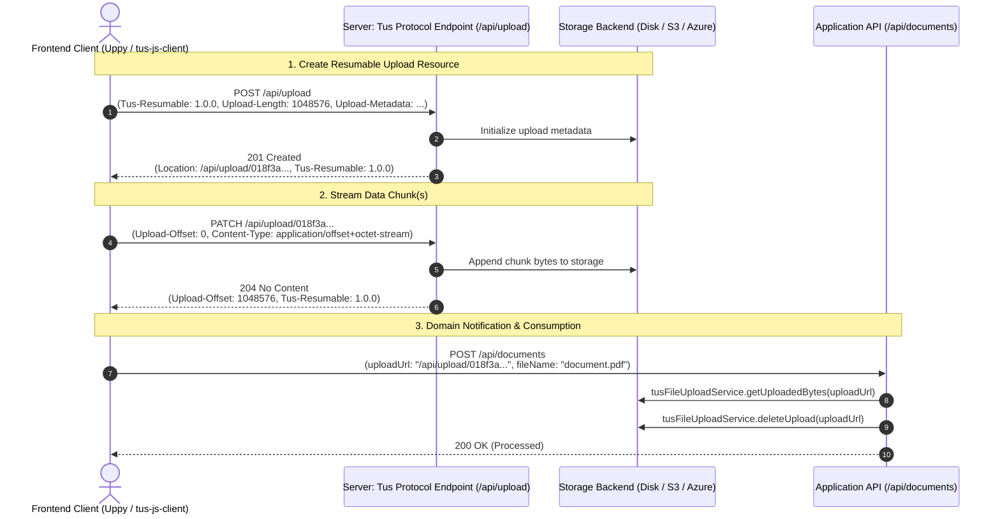
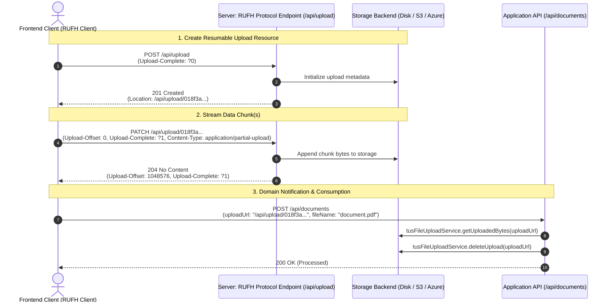

# Protocols: Tus 1.0.0 & IETF Resumable Uploads for HTTP (RUFH)

`tus-java-server` serves **both** resumable upload protocols on the same endpoint:

1. **Tus 1.0.0**: the widely-adopted [tus protocol standard](https://tus.io/).
2. **IETF Resumable Uploads for HTTP (RUFH)**: the official IETF standardization draft ([draft-ietf-httpbis-resumable-upload](https://datatracker.ietf.org/doc/draft-ietf-httpbis-resumable-upload/), implemented at **draft-12**).

> [!WARNING]
> **Experimental Feature Disclaimer**: The IETF Resumable Uploads for HTTP (RUFH) specification (`draft-ietf-httpbis-resumable-upload`) is currently an active IETF draft. While this library implements draft-12 compliance, the RUFH protocol support should be considered **experimental** until the specification is published as an official RFC standard.

Migrating clients from Tus to RUFH? See the [RUFH Migration Guide](MIGRATION.md). Upgrading the Java library? See the [Upgrade Guide](UPGRADING.md).

## Configuring the Protocol Version

Configure protocol support via `withSupportedProtocolVersions(ProtocolVersion)`:

* `ProtocolVersion.AUTO` (Default): Automatically detects the protocol version per HTTP request based on request headers (`Tus-Resumable` header triggers Tus 1.0.0; `Upload-Complete` header or `application/partial-upload` content type triggers IETF RUFH).
* `ProtocolVersion.TUS_1_0_0`: Enforces Tus 1.0.0 handling exclusively.
* `ProtocolVersion.RUFH`: Enforces IETF Resumable Uploads for HTTP (RUFH) handling exclusively.

## How the Protocols Work

### Tus 1.0.0 Protocol Flow


### IETF Resumable Uploads for HTTP (RUFH) Flow


## Protocol Comparison & Available Features

| Feature / Capability | Tus 1.0.0 | IETF Resumable Uploads |
|---|---|---|
| **Auto-Detection Signal** | `Tus-Resumable: 1.0.0` header | `Upload-Complete` header or `Content-Type: application/partial-upload` |
| **Creation** | `POST` with `Upload-Length` / `Upload-Defer-Length` | `POST` with `Upload-Complete: ?0` / `?1` (or `application/partial-upload`) |
| **Append Chunks** | `PATCH` with `Upload-Offset` | `PATCH` with `Upload-Offset` & `Content-Type: application/partial-upload` |
| **Upload Status Query** | `HEAD` returns `Upload-Offset` & `Upload-Length` | `HEAD` returns `Upload-Offset` & `Upload-Complete` |
| **Offset Mismatch Error** | HTTP 409 Conflict | HTTP 409 Conflict with RFC 7807 `application/problem+json` details |
| **104 Interim Responses** | N/A | Supported (see [INTERIM_RESPONSES.md](INTERIM_RESPONSES.md)) |
| **Upload Cancellation** | `DELETE` with `Tus-Resumable: 1.0.0` | `DELETE` with `Upload-Complete: ?0` |
| **Checksum Validation** | Supported (`Checksum` extension) | Supported (based on HTTP Digests / RFC 9530) |
| **Expiration Handling** | Supported (`Upload-Expires` header) | Supported (`max-age` parameter in `Upload-Limit` header) |
| **Concatenation** | Supported (`Concatenation` extension) | N/A |
| **Download Extension** | Supported (`Download` extension) | Supported (`Download` extension; without it, `GET` requests perform offset retrieval) |

## Protocol Extensions

Besides the [tus core protocol](https://tus.io/protocols/resumable-upload.html#core-protocol), the library has all optional tus protocol extensions enabled by default. This means that the `Tus-Extension` header has value `creation,creation-defer-length,creation-with-upload,checksum,checksum-trailer,termination,expiration,concatenation,concatenation-unfinished`. Optionally you can also enable an unofficial `download` extension (see the [Configuration Reference](CONFIGURATION.md)).

* [creation](https://tus.io/protocols/resumable-upload.html#creation): The creation extension allows you to create new uploads and to retrieve the upload URL for them.
* [creation-defer-length](https://tus.io/protocols/resumable-upload.html#post): You can create a new upload even if you don't know its final length at the time of creation.
* [creation-with-upload](https://tus.io/protocols/resumable-upload.html#creation): The creation-with-upload extension allows you to create the upload resource and upload initial file data in a single POST request.
* [checksum](https://tus.io/protocols/resumable-upload.html#checksum): An extension that allows you to verify data integrity of each upload (PATCH) request.
* [checksum-trailer](https://tus.io/protocols/resumable-upload.html#checksum): If the checksum hash cannot be calculated at the beginning of the upload, it may be included as a trailer HTTP header at the end of the chunked HTTP request.
* [termination](https://tus.io/protocols/resumable-upload.html#termination): Clients can terminate completed or in-progress uploads which allows the tus-java-server library to free up resources on the server.
* [expiration](https://tus.io/protocols/resumable-upload.html#expiration): You can instruct the tus-java-server library to cleanup uploads that are older than a configurable period. The expiration extension applies to both Tus 1.0.0 and IETF Resumable Uploads for HTTP (RUFH) protocols:
  * **Tus 1.0.0 Protocol**: Expiration is communicated to clients via the `Upload-Expires` response header field formatted as an HTTP date-time (RFC 7231, e.g. `Upload-Expires: Wed, 25 Jun 2026 16:00:00 GMT`).
  * **IETF RUFH Protocol**: Expiration is communicated to clients via the `max-age` parameter in the `Upload-Limit` response header field indicating remaining valid seconds (e.g. `Upload-Limit: max-size=1048576, max-age=3600`).
* [concatenation](https://tus.io/protocols/resumable-upload.html#concatenation): This extension can be used to concatenate multiple uploads into a single final upload enabling clients to perform parallel uploads and to upload non-contiguous chunks.
* [concatenation-unfinished](https://tus.io/protocols/resumable-upload.html#concatenation): The client is allowed send the request to concatenate partial uploads while these partial uploads are still in progress.
* [http-digests](https://datatracker.ietf.org/doc/rfc9530/): An extension implementing RFC 9530 to verify data integrity for the Resumable Uploads for HTTP (RUFH) protocol. Supported headers include `Content-Digest`, `Repr-Digest`, `Want-Content-Digest`, and `Want-Repr-Digest`.
* `download`: The (unofficial) download extension allows clients to download uploaded files using a HTTP `GET` request. You can enable this extension by calling the `withDownloadFeature()` method.
* `cors`: The (unofficial) CORS extension adds native CORS support out-of-the-box, setting CORS headers for all requests and responses, and handling preflight `OPTIONS` requests automatically. It is enabled by default, so you do **not** need `@CrossOrigin` or a separate CORS filter on your upload endpoint. Disable it with `disableTusExtension("cors")` if you manage CORS yourself.

## HTTP Digests ([RFC 9530](https://www.rfc-editor.org/rfc/rfc9530.html))

The `http-digests` extension implements RFC 9530 to support data integrity checks for both individual data chunks (`Content-Digest`) and the entire file (`Repr-Digest`).

* **Performance Disclaimer**: Calculating representation digests (`Repr-Digest`) requires streaming the entire uploaded file from disk. For extremely large files, this can introduce non-trivial I/O performance overhead on the server. To optimize, only request it via `Want-Repr-Digest` when absolutely necessary.

## HTTP 104 Interim Responses

The IETF draft allows the server to send `104 Upload Resumption Supported` interim responses. The Servlet API cannot emit 1xx responses natively; see the [HTTP 104 Interim Responses Guide](INTERIM_RESPONSES.md) for a Tomcat `Valve` (including Spring Boot registration). A live reference implementation using cached reflection is available in the [tus-java-server-spring-demo](https://github.com/tomdesair/tus-java-server-spring-demo) repository: [`TusInterimResponseTomcatValve`](https://github.com/tomdesair/tus-java-server-spring-demo/blob/main/spring-boot-rest/src/main/java/me/desair/spring/tus/TusInterimResponseTomcatValve.java).

To register the Valve in Spring Boot via `TomcatServletWebServerFactory`:

```java
@Bean
public TomcatServletWebServerFactory tomcatFactory(TusFileUploadService tusFileUploadService) {
    TomcatServletWebServerFactory factory = new TomcatServletWebServerFactory();
    factory.addContextValves(new TusInterimResponseTomcatValve(tusFileUploadService));
    return factory;
}
```

## Compatible Clients & Conformity Testing

This server implementation has been tested with:
- **Tus 1.0.0 Clients & Conformity Tests**: [Uppy](https://uppy.io/), `tus-js-client`, and the built-in Tus v1.0.0 conformity test suite (`scripts/tus_conformity_test.py`) validating all core protocol mechanisms and protocol extensions (creation, creation-with-upload, checksum, termination, concatenation, and expiration) across Disk, S3, and Azure Blob backends.
- **IETF Resumable Uploads Clients & Conformity Tests**: The built-in RUFH conformity test suite (`scripts/rufh_conformity_test.py`) validating compliance with draft-12 of the RUFH specification and RFC 9530 HTTP Digests, as well as the community [RUFH conformity tests from the IETF hackathon](https://github.com/tus/ietf-hackathon).

See the [Conformity Testing Guide](CONFORMITY_TESTING.md) for how to run the suites. The repository also contains automated integration test suites (`ITTusFileUploadService`, `RufhProtocolCreationTest`, `RufhProtocolAppendTest`, `RufhProtocolHeadTest`, `RufhProtocolCancellationTest`) validating both protocol specifications.
